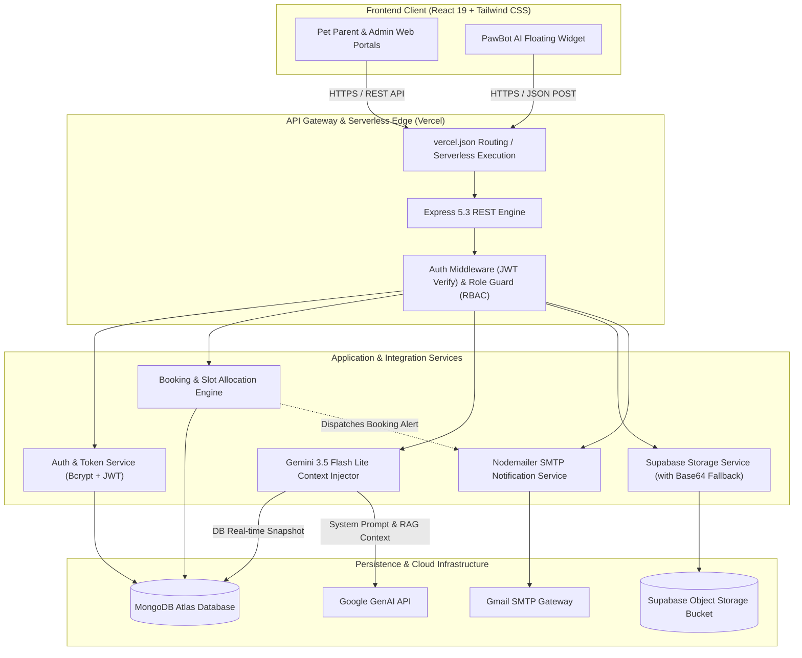

<p align="center">
  
</p>

<h1 align="center">PetCare & Vet Clinic Appointment System</h1>

<p align="center">
  <b>Enterprise-grade Veterinary Clinical Practice & Pet Healthcare Appointment Management Platform</b><br />
  Final Coursework Project for Rapid Application Development (RAD &bull; ITS2020) &bull; IJSE Semester 03
</p>

<p align="center">
  <a href="https://pet-care-and-vet-clinic.vercel.app/"></a>
  <a href="https://pet-care-and-vet-clinic-backend.vercel.app/"></a>
  <a href="https://github.com/nodejs/node"></a>
  <a href="https://expressjs.com/"></a>
  <a href="https://www.typescriptlang.org/"></a>
  <a href="https://www.mongodb.com/"></a>
  <a href="https://supabase.com/"></a>
  <a href="https://ai.google.dev/"></a>
</p>

---

### 🌐 Hosted Production Deployments

| Component | Target URL | Status | Description |
| :--- | :--- | :---: | :--- |
| **Client & Admin Web Portal** | [https://pet-care-and-vet-clinic.vercel.app/](https://pet-care-and-vet-clinic.vercel.app/) |  | React 19 SPA, Tailwind CSS, Lucide Icons |
| **Backend RESTful API** | [https://pet-care-and-vet-clinic-backend.vercel.app/](https://pet-care-and-vet-clinic-backend.vercel.app/) |  | Serverless Express 5 engine on Vercel Node runtime |
| **API Base Endpoint** | `https://pet-care-and-vet-clinic-backend.vercel.app/api` |  | CORS enabled for client origin |

#### 🔑 Pre-Configured Test Credentials

For evaluation and demonstration purposes, the database is pre-seeded with test profiles:

| Account Type | Email | Password | Assigned Permissions |
| :--- | :--- | :--- | :--- |
| **Clinic Administrator** | `admin@petcare.com` | `admin123` | Full administrative control, doctor rosters, clinical services, all bookings |
| **Pet Parent (Client)** | `user@petcare.com` | `user123` | Pet profile management, 5-stage booking flow, personal appointment history |

> *Self-registration is also available via the client interface with instant email confirmation and password reset support.*

---

## 📋 Table of Contents

- [Executive Summary](#-executive-summary)
- [System Architecture](#-system-architecture)
- [Core Functional Modules](#-core-functional-modules)
  - [1. Authentication, Authorization & Security](#1-authentication-authorization--security)
  - [2. Multi-Step Appointment Booking Engine](#2-multi-step-appointment-booking-engine)
  - [3. Doctor Shift & Schedule Management](#3-doctor-shift--schedule-management)
  - [4. Pet Records & Medical Profiles](#4-pet-records--medical-profiles)
  - [5. PawBot — Context-Aware Veterinary AI](#5-pawbot--context-aware-veterinary-ai)
  - [6. Cloud Storage & Automated Email Service](#6-cloud-storage--automated-email-service)
- [Database Entity Relationships](#-database-entity-relationships)
- [REST API Reference](#-rest-api-reference)
  - [Authentication & Account Recovery (`/api/auth`)](#authentication--account-recovery-apiauth)
  - [Appointments & Slot Allocation (`/api/appointments`)](#appointments--slot-allocation-apiappointments)
  - [Veterinarian Management (`/api/doctors`)](#veterinarian-management-apidoctors)
  - [Doctor Working Schedules (`/api/doctor-schedules`)](#doctor-working-schedules-apidoctor-schedules)
  - [Clinical Services (`/api/services`)](#clinical-services-apiservices)
  - [Pet Profiles (`/api/pets`)](#pet-profiles-apipets)
  - [AI Assistant (`/api/ai`)](#ai-assistant-apiai)
- [Local Development & Setup Guide](#-local-development--setup-guide)
  - [Prerequisites](#prerequisites)
  - [Backend Setup](#1-backend-setup)
  - [Frontend Setup](#2-frontend-setup)
  - [Environment Variables Specification](#environment-variables-specification)
- [Deployment Configuration](#-deployment-configuration)
- [Academic Metadata](#-academic-metadata)

---

## 📌 Executive Summary

Veterinary practices frequently face administrative friction resulting from manual telephone appointment logs, double-booked consultation slots, fragmented patient histories, and lack of real-time visibility into doctor availability.

The **PetCare & Vet Clinic Appointment System** resolves these operational bottlenecks through a cloud-native, decoupled client-server architecture:
- **Client Web Application**: Built with React 19, TypeScript, and Tailwind CSS. Features an intuitive 5-step appointment booking wizard, interactive slot calendar, medical record manager, and real-time AI consultation chat.
- **Backend Service**: An Express 5 / TypeScript micro-service architecture deployed on Vercel Serverless. Handles cryptographic authentication, database transactions via Mongoose / MongoDB Atlas, transactional SMTP email triggers via Nodemailer, resilient binary storage on Supabase with Base64 fallback, and real-time RAG-prompted veterinary intelligence via the Google Gemini 3.5 Flash Lite engine.

---

## 🏗 System Architecture



---

## 🚀 Core Functional Modules

### 1. Authentication, Authorization & Security
- **Dual-Token JWT Strategy**: Short-lived access tokens paired with secure refresh token rotation to minimize token exposure.
- **Role-Based Access Control (RBAC)**: Distinct authorization barriers for `UserRole.USER` and `UserRole.ADMIN`.
- **Credential Protection**: One-way salted hashing using `bcryptjs` (salt factor 10).
- **Self-Service Password Recovery**: End-to-end OTP password reset workflow generating cryptographically secure 6-digit tokens transmitted via transactional email with a 15-minute validity window.

### 2. Multi-Step Appointment Booking Engine
The consultation scheduler guides pet parents through a structured 5-stage validation flow:
1. **Pet Selection**: Choose from currently registered pets or register a new animal in-line.
2. **Doctor Selection**: Filter verified veterinarians by medical discipline and availability.
3. **Clinical Service Selection**: Select consultation procedures (e.g., General Wellness, Vaccinations, Dental Scaling, Minor Surgery) with transparent durations and cost in LKR.
4. **Intelligent Slot Resolver**: Inspects the doctor's weekly operational schedule, cross-checks against existing bookings for that calendar date, and exposes only unoccupied time slots.
5. **Confirmation & Booking Dispatch**: Persists the appointment in MongoDB and synchronously triggers a formatted HTML booking confirmation email to the owner.

### 3. Doctor Shift & Schedule Management
- Administrative controls to configure recurring weekly consultation shifts per doctor.
- Parameters include assigned working day (`Monday` through `Sunday`), starting time, ending time, and maximum booking capacities per slot window.
- Public read access enables client-side dynamic rendering of doctor shifts.

### 4. Pet Records & Medical Profiles
- Supports multiple pet species: Dog, Cat, Bird, Rabbit, and exotic pets.
- Records pet name, breed, age, gender, medical history notes, and existing allergies.
- Media upload integration: Pet profile photos are automatically uploaded to Supabase Storage with clean UUID-prefixed file sanitization.

### 5. PawBot — Context-Aware Veterinary AI
- Powered by the `@google/genai` SDK running `gemini-3.5-flash-lite`.
- **Live Database Context Injection (RAG)**: When an inquiry is submitted, the backend fetches real-time records of active veterinarians, clinical services, pricing, and operational hours, injecting them into the system instruction prompt.
- **Strict Guardrails**: PawBot enforces strict boundary constraints, rejecting non-veterinary queries (e.g., programming, general knowledge) to maintain clinical focus.

### 6. Cloud Storage & Automated Email Service
- **Resilient Media Pipeline**: `Multer` processes multipart binary streams into memory. The upload service uploads files to Supabase cloud buckets. If bucket rate-limits or misconfigurations occur, it fails over seamlessly to an inline Base64 data URI format, ensuring zero UI breakage.
- **HTML Transactional Emails**: Dispatches styled confirmation cards containing the reference ID, scheduled date/time, doctor name, pet profile, and clinic contact information.

---

## 🗄 Database Entity Relationships

```
┌──────────────────────┐         ┌─────────────────────────┐
│        USERS         │         │          PETS           │
├──────────────────────┤         ├─────────────────────────┤
│ _id: ObjectId        │ 1     * │ _id: ObjectId           │
│ name: String         ├────────<│ ownerId: ObjectId (Ref) │
│ email: String (UQ)   │         │ name: String            │
│ password: String     │         │ category: String        │
│ roles: [String]      │         │ breed: String           │
│ phone: String        │         │ age: Number             │
│ resetPasswordToken   │         │ gender: String          │
│ resetPasswordExpires │         │ imageUrl: String        │
└──────────┬───────────┘         └────────────┬────────────┘
           │ 1                                │ 1
           │                                  │
           │ *                                │ *
┌──────────┴──────────────────────────────────┴────────────┐
│                       APPOINTMENTS                       │
├──────────────────────────────────────────────────────────┤
│ _id: ObjectId                                            │
│ userId: ObjectId (Ref -> USERS)                          │
│ petId: ObjectId (Ref -> PETS)                            │
│ doctorId: ObjectId (Ref -> DOCTORS)                      │
│ serviceId: ObjectId (Ref -> SERVICES)                    │
│ date: String (YYYY-MM-DD)                                │
│ timeSlot: String (HH:mm - HH:mm)                         │
│ reason: String                                           │
│ status: 'PENDING' | 'CONFIRMED' | 'COMPLETED' | 'CANCEL' │
│ notes: String                                            │
└──────────┬──────────────────────────────────┬────────────┘
           │ *                                │ *
           │ 1                                │ 1
┌──────────┴───────────┐         ┌────────────┴────────────┐
│       DOCTORS        │         │        SERVICES         │
├──────────────────────┤         ├─────────────────────────┤
│ _id: ObjectId        │ 1     * │ _id: ObjectId           │
│ name: String         ├────────<│ name: String            │
│ specialization: Str  │         │ description: String     │
│ phone: String        │         │ price: Number (LKR)     │
│ email: String        │         │ duration: Number (mins) │
│ imageUrl: String     │         │ isActive: Boolean       │
│ status: 'ACTIVE'|... │         └─────────────────────────┘
└──────────┬───────────┘
           │ 1
           │ *
┌──────────┴───────────┐
│   DOCTOR_SCHEDULES   │
├──────────────────────┤
│ _id: ObjectId        │
│ doctorId: ObjectId   │
│ dayOfWeek: String    │
│ startTime: String    │
│ endTime: String      │
│ maxAppointments: Num │
└──────────────────────┘
```

---

## 📡 REST API Reference

### Base URL
All API requests are routed through `/api`:
- **Local**: `http://localhost:3000/api`
- **Production**: `https://pet-care-and-vet-clinic-backend.vercel.app/api`

---

### Authentication & Account Recovery (`/api/auth`)

| Method | Endpoint | Access Level | Description |
| :--- | :--- | :--- | :--- |
| `POST` | `/api/auth/register` | Public | Register a new user (`name`, `email`, `password`, `phone`) |
| `POST` | `/api/auth/login` | Public | Authenticate user; returns `accessToken`, `refreshToken`, and user payload |
| `POST` | `/api/auth/refresh` | Public | Rotate and obtain a new `accessToken` using a valid refresh token |
| `GET` | `/api/auth/me` | Authenticated | Fetch active user session and profile details |
| `GET` | `/api/auth/admin` | Admin Only | Validates administrative privileges |
| `POST` | `/api/auth/forgot-password` | Public | Sends a 6-digit OTP code to the requested email |
| `POST` | `/api/auth/reset-password` | Public | Resets user password using the verified token |

#### Sample Login Request
```bash
curl -X POST https://pet-care-and-vet-clinic-backend.vercel.app/api/auth/login \
  -H "Content-Type: application/json" \
  -d '{
    "email": "user@petcare.com",
    "password": "user123"
  }'
```

---

### Appointments & Slot Allocation (`/api/appointments`)

| Method | Endpoint | Access Level | Description |
| :--- | :--- | :--- | :--- |
| `GET` | `/api/appointments/booked-slots` | Public | Query booked slots (`?doctorId=...&date=YYYY-MM-DD`) |
| `POST` | `/api/appointments` | Authenticated | Create an appointment & dispatch confirmation email |
| `GET` | `/api/appointments/my-appointments` | Authenticated | List all appointments belonging to current user |
| `PUT` | `/api/appointments/:id/status` | Authenticated / Admin | Update status (`PENDING`, `CONFIRMED`, `COMPLETED`, `CANCELLED`) |
| `PUT` | `/api/appointments/:id/cancel` | Authenticated | Cancel personal appointment |
| `GET` | `/api/appointments/all` | Admin Only | Administrative overview of all clinic appointments |

#### Sample Appointment Booking Payload
```json
{
  "petId": "6737bc2e4822f30b91e9f1a2",
  "doctorId": "6737a4c24822f30b91e9f0d1",
  "serviceId": "6737ab514822f30b91e9f0fe",
  "date": "2026-11-20",
  "timeSlot": "09:00 AM - 09:30 AM",
  "reason": "Routine annual vaccination and wellness checkup",
  "notes": "Pet gets slightly anxious in waiting rooms."
}
```

---

### Veterinarian Management (`/api/doctors`)

| Method | Endpoint | Access Level | Description |
| :--- | :--- | :--- | :--- |
| `GET` | `/api/doctors` | Public | List all active veterinarians with specializations and contact |
| `POST` | `/api/doctors` | Admin Only | Onboard doctor with photo upload (`multipart/form-data`) |
| `PUT` | `/api/doctors/:id` | Admin Only | Update doctor details and profile image |
| `DELETE` | `/api/doctors/:id` | Admin Only | Remove doctor profile from the clinic directory |

---

### Doctor Working Schedules (`/api/doctor-schedules`)

| Method | Endpoint | Access Level | Description |
| :--- | :--- | :--- | :--- |
| `POST` | `/api/doctor-schedules` | Authenticated / Admin | Create or update weekly shift hours for a veterinarian |
| `GET` | `/api/doctor-schedules/:doctorId` | Public | Retrieve active weekly working schedule for a given doctor |

---

### Clinical Services (`/api/services`)

| Method | Endpoint | Access Level | Description |
| :--- | :--- | :--- | :--- |
| `GET` | `/api/services` | Public | List all published clinic services with pricing (LKR) and duration |
| `POST` | `/api/services` | Admin Only | Register a new clinical procedure or checkup tier |
| `PUT` | `/api/services/:id` | Admin Only | Modify service name, description, duration, or fee |
| `DELETE` | `/api/services/:id` | Admin Only | Remove service from active catalogue |

---

### Pet Profiles (`/api/pets`)

| Method | Endpoint | Access Level | Description |
| :--- | :--- | :--- | :--- |
| `POST` | `/api/pets` | Authenticated | Register a pet with picture (`multipart/form-data`) |
| `GET` | `/api/pets/my-pets` | Authenticated | Retrieve all pets owned by the authenticated user |
| `PUT` | `/api/pets/:id` | Authenticated | Update pet demographics or health records |
| `DELETE` | `/api/pets/:id` | Authenticated | Remove pet profile |
| `GET` | `/api/pets/all` | Admin Only | Master registry of all pets registered with the clinic |

---

### AI Assistant (`/api/ai`)

| Method | Endpoint | Access Level | Description |
| :--- | :--- | :--- | :--- |
| `POST` | `/api/ai/chat` | Public | Interact with PawBot AI; injects live database context |

#### Sample AI Assistant Request
```bash
curl -X POST https://pet-care-and-vet-clinic-backend.vercel.app/api/ai/chat \
  -H "Content-Type: application/json" \
  -d '{
    "message": "Which doctors are available for feline vaccination, and what are their working hours?"
  }'
```

---

## 🛠 Local Development & Setup Guide

### Prerequisites
- **Node.js**: `v18.x` or higher
- **Package Manager**: `npm` (v9+)
- **Database**: Local MongoDB instance or free [MongoDB Atlas Cluster](https://www.mongodb.com/atlas)
- **Object Storage**: [Supabase Cloud Project](https://supabase.com/) with a storage bucket (e.g. `articles` or `petcare`)
- **Email Service**: Gmail account with an App Password or any SMTP provider
- **AI Engine**: [Google AI Studio API Key](https://aistudio.google.com/) for Gemini models

---

### 1. Backend Setup

```bash
# Clone the repository
git clone https://github.com/your-username/ITS2020-Pet-Care-and-Vet-Clinic-Appointment-System-Backend.git
cd ITS2020-Pet-Care-and-Vet-Clinic-Appointment-System-Backend

# Install dependencies
npm install

# Initialize environment variables
cp .example.env .env
```

Open `.env` in your editor and configure the keys:

```env
PORT=3000
MONGO_LOCAL_URL=mongodb+srv://<username>:<password>@cluster0.mongodb.net/petcare_db?retryWrites=true&w=majority

JWT_SECRET=your_super_secret_jwt_access_key
JWT_REFRESH_SECRET=your_super_secret_jwt_refresh_key

# Supabase Storage Credentials
SUPERBASE_URL=https://your-project-id.supabase.co
SUPERBASE_KEY=your_supabase_service_role_or_anon_key

# SMTP Notification Credentials
EMAIL_HOST=smtp.gmail.com
EMAIL_PORT=587
EMAIL_USER=your-clinic-notification-email@gmail.com
EMAIL_PASS=your-gmail-16-char-app-password

# Google Gemini AI Integration
GEMINI_API_KEY=AIzaSy...your_gemini_api_key_here
```

Start the backend development server:

```bash
npm run dev
# Server initiates at http://localhost:3000 with tsx file watcher
```

---

### 2. Frontend Setup

In a separate terminal:

```bash
# Navigate to the frontend directory
cd ../ITS2020-Pet-Care-and-Vet-Clinic-Appointment-System-Frontend

# Install dependencies
npm install

# Create environment configuration
cp .env.example .env
```

Set the backend API connection in the frontend `.env`:

```env
# For local backend:
VITE_API_BASE_URL=http://localhost:3000/api

# For production backend:
# VITE_API_BASE_URL=https://pet-care-and-vet-clinic-backend.vercel.app/api
```

Start the Vite development server:

```bash
npm run dev
# Client application launches at http://localhost:5173
```

---

### Environment Variables Specification

| Key | Required | Type | Purpose |
| :--- | :---: | :---: | :--- |
| `PORT` | Optional | `Number` | HTTP port for local Express listener (default: `3000`). |
| `MONGO_LOCAL_URL` | **Yes** | `String` | MongoDB connection URI (local `mongodb://` or Atlas `mongodb+srv://`). |
| `JWT_SECRET` | **Yes** | `String` | Secret key used to sign standard access tokens. |
| `JWT_REFRESH_SECRET`| **Yes** | `String` | Secret key used to sign session refresh tokens. |
| `SUPERBASE_URL` | **Yes** | `String` | Supabase project API URL (`https://xyz.supabase.co`). |
| `SUPERBASE_KEY` | **Yes** | `String` | Supabase API authorization key with storage bucket access. |
| `EMAIL_HOST` | **Yes** | `String` | SMTP server host (e.g., `smtp.gmail.com`). |
| `EMAIL_PORT` | **Yes** | `Number` | SMTP transmission port (e.g., `587` for TLS / `465` for SSL). |
| `EMAIL_USER` | **Yes** | `String` | Originating email address for transactional dispatches. |
| `EMAIL_PASS` | **Yes** | `String` | SMTP authentication app password. |
| `GEMINI_API_KEY` | **Yes** | `String` | Google GenAI API key for the PawBot RAG assistant. |

---

## ☁️ Deployment Configuration

The backend is configured for zero-configuration serverless deployment on **Vercel** via `vercel.json`:

```json
{
  "version": 2,
  "builds": [
    {
      "src": "src/index.ts",
      "use": "@vercel/node"
    }
  ],
  "routes": [
    {
      "src": "/(.*)",
      "dest": "src/index.ts",
      "methods": ["GET", "POST", "PUT", "DELETE", "OPTIONS"]
    }
  ]
}
```

The application checks `process.env.NODE_ENV !== "production"` before calling `app.listen()`, seamlessly switching between persistent local execution and serverless request dispatch on Vercel's global edge network.

---

## 🎓 Academic Metadata

- **Institution**: [Institute of Software Engineering (IJSE)](https://www.ijse.lk/)
- **Program**: Graduate Diploma in Software Engineering (GDSE) / Higher National Diploma
- **Semester**: Semester 03
- **Module**: Rapid Application Development (RAD &bull; Coursework Module ITS2020)
- **Project**: Pet Care and Veterinary Clinic Online Consultation & Appointment Scheduling System

---

<p align="center">
  <b>PetCare & Vet Clinic</b> &bull; Engineering dependable healthcare management for pets and their companions. 🐾
</p>