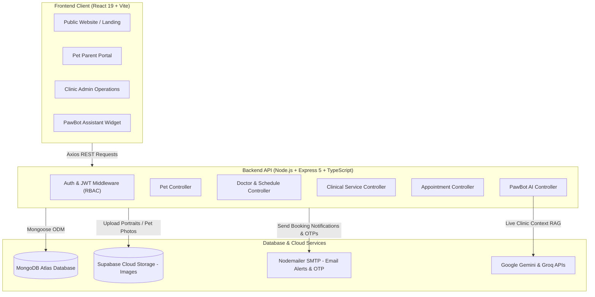
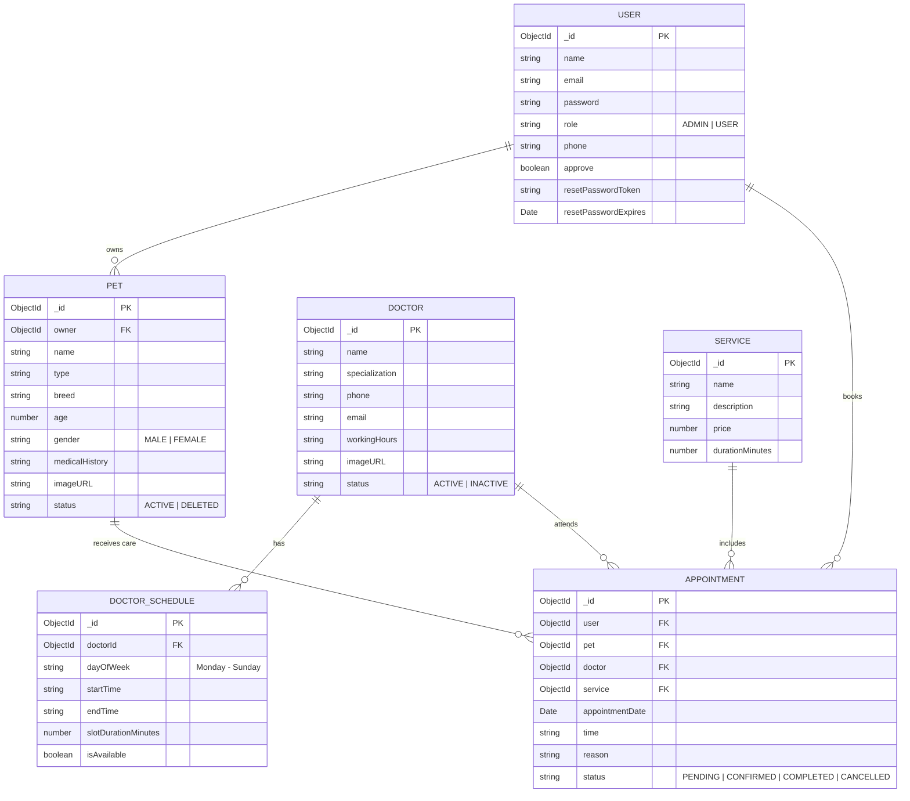

<p align="center">
  
</p>

<h1 align="center">PetCare & Vet Clinic</h1>
<h3 align="center">Online Appointment Booking & Veterinary Clinical Management System</h3>

<p align="center">
  A production-ready, full-stack veterinary clinic management platform designed to streamline patient onboarding, veterinary doctor shift scheduling, multi-step appointment booking, automated email alerts, and an intelligent clinic AI assistant.
</p>

<p align="center">
  <a href="https://pet-care-and-vet-clinic.vercel.app/"></a>
  <a href="https://pet-care-and-vet-clinic-backend.vercel.app/"></a>
  
  
  
  
  
  
</p>

---

## 📌 Project Overview

**PetCare & Vet Clinic** is developed as the Final Coursework for **Rapid Application Development (RAD - ITS2020)** in **Semester 03** at the **Institute of Software Engineering (IJSE)**.

Veterinary clinics regularly face hurdles with manual telephone scheduling: double-booked consultation slots, fragmented pet medical histories, unorganized doctor shift rosters, and delayed communication with pet parents. This system addresses these challenges through a unified cloud platform featuring dedicated **Client (Pet Parent)** and **Administrative (Clinic Staff)** portals, automated Nodemailer email notifications, cloud media hosting with Supabase, and an intelligent context-aware virtual assistant.

### 🔗 Live Deployments

| Resource | Deployment URL |
| :--- | :--- |
| **Frontend Web Application** | [https://pet-care-and-vet-clinic.vercel.app/](https://pet-care-and-vet-clinic.vercel.app/) |
| **Backend REST API** | [https://pet-care-and-vet-clinic-backend.vercel.app/](https://pet-care-and-vet-clinic-backend.vercel.app/) |

---

## ✨ Key System Features

### 🐾 1. Pet Parent (Client) Portal
- **Robust Authentication & Security**:
  - Stateless JWT access and refresh token management with bcrypt password hashing.
  - **Self-Service Password Recovery**: Secure 6-digit OTP verification codes delivered via email (Nodemailer) with a 15-minute expiration window.
- **Pet Registry & Health Profile**:
  - Register pets with category (Dog, Cat, Bird, Rabbit, etc.), breed, age, and gender.
  - Profile photo uploads directly streamed through Multer memory storage into **Supabase Storage**.
  - Maintain historical health backgrounds, allergies, and ongoing treatment notes.
  - Soft-delete capability preserving historical appointment integrity.
- **Interactive Multi-Step Appointment Booking**:
  1. *Step 1 — Select Pet*: Choose an existing registered pet or quickly onboard a new pet.
  2. *Step 2 — Select Veterinarian*: Choose an active doctor filtered by clinical specialization.
  3. *Step 3 — Select Clinical Service*: Pick from clinical procedures (Wellness Exam, Dental Scaling, Vaccinations, Surgery) with standard pricing (LKR) and durations.
  4. *Step 4 — Date & Time Slot Picker*: Real-time slot allocation based on the doctor's weekly roster; prevents overlapping bookings.
  5. *Step 5 — Confirmation*: Complete booking overview with appointment reason and special care instructions.
- **Appointment Tracking**: Live overview of past and upcoming consultations with dynamic badges (`PENDING`, `CONFIRMED`, `COMPLETED`, `CANCELLED`).
- **Instant Email Confirmation**: Automatic HTML transactional confirmation emails dispatched directly to the pet parent upon booking.

---

### 🩺 2. Clinic Operations (Admin) Portal
- **Operational Dashboard**: System-wide counts of total appointments, registered veterinarians, clinical services, and registered pets.
- **Veterinary Specialist Management**:
  - Register and manage doctors with specialized fields, contact numbers, email, working hours, and profile photos.
  - Toggle doctor active status on the clinic floor.
- **Doctor Shift Scheduling Roster**:
  - Configure daily consulting hours for each day of the week (Monday through Sunday).
  - Configurable consultation slot intervals (15, 30, 45, or 60 minutes).
  - Real-time availability toggling for leave or unexpected off-duty hours.
- **Clinical Services Directory**:
  - Full CRUD operations for veterinary procedures, checkups, vaccinations, and surgeries.
  - Define standard consultation fees (LKR), duration requirements, and preparation instructions.
- **Appointment Lifecycle Dispatcher**:
  - Real-time clinic appointment overview populated with complete user, pet, doctor, and service details.
  - Manage status transitions: Confirm bookings, mark consultations completed, or cancel.
- **System-Wide Pet Directory**: Access full records of all active registered pets in the clinic.

---

### 🤖 3. PawBot — Virtual Clinic Assistant
- **Real-Time Database Context (RAG)**: PawBot queries live MongoDB data on every question to provide up-to-the-minute doctor availability, weekly timetables, and clinic services.
- **Strict Domain Boundary Guardrails**:
  - Solely dedicated to PetCare & Vet Clinic queries, appointments, doctors, and domestic pet health advice.
  - Politely and firmly declines out-of-scope inquiries (general programming, math, world politics, movies, etc.).
- **Dual LLM Architecture**: Built with Google Gemini (`@google/genai`) and Groq (`groq-sdk` with `llama-3.3-70b-versatile` / `llama-3.1-8b-instant`) with automatic fallback.
- **Bilingual Support**: Fluent and natural responses in both English and Sinhala / Singlish.

---

### 🎨 4. Modern UI & Glassmorphic Design
- **Theme Switcher**: Complete Light Mode and Dark Mode support with local storage persistence.
- **Portal Modals**: High-performance React Portals (`createPortal`) mounting cleanly to `document.body` with deep `backdrop-blur-md` frosted glass overlays and scroll lock.
- **Responsive Layout**: Mobile-first architecture optimized across mobile, tablet, and widescreen desktop monitors.

---

## 🏗️ System Architecture



---

## 💻 Tech Stack

### Frontend
| Technology | Description |
| :--- | :--- |
| **React 19** | Next-generation declarative component-based UI library |
| **TypeScript** | Strict compile-time typing for UI state and API contracts |
| **Vite** | Blazing fast ESM frontend development and build tooling |
| **Tailwind CSS** | Utility-first CSS framework with medical teal accents & dark mode |
| **React Router v7** | Declarative client-side routing with protected role-based routes |
| **Lucide React** | Clean, accessible SVG icon suite |
| **Axios** | HTTP client with automatic bearer token attachment & interceptors |
| **React Hot Toast** | Lightweight toast notifications |

### Backend
| Technology | Description |
| :--- | :--- |
| **Node.js & Express 5** | High-performance server runtime and RESTful API framework |
| **TypeScript** | End-to-end type safety across controllers, models, and routes |
| **MongoDB & Mongoose** | Cloud NoSQL document database with strict schema validation |
| **JWT & bcryptjs** | Secure token-based authentication with role-based access control |
| **Supabase Storage** | Cloud bucket storage for pet photos and doctor portraits |
| **Nodemailer** | SMTP email client for appointment alerts and 6-digit OTP verification |
| **Google Gemini & Groq** | LLM engines driving PawBot with real-time MongoDB RAG context |
| **Multer** | Multipart form-data handling for memory-buffered image uploads |
| **Vercel Serverless** | Zero-downtime serverless cloud deployment |

---

## 🗄️ Database Schema Overview



---

## 📡 REST API Reference

### 🔐 Authentication (`/api/auth`)
| Method | Endpoint | Access | Description |
| :--- | :--- | :--- | :--- |
| `POST` | `/register` | Public | Register a new pet parent account |
| `POST` | `/login` | Public | Authenticate user & receive access/refresh tokens |
| `POST` | `/refresh-token` | Public | Refresh expired JWT access token |
| `GET` | `/me` | User / Admin | Retrieve current logged-in user profile |
| `POST` | `/forgot-password` | Public | Send 6-digit OTP verification code via email |
| `POST` | `/reset-password` | Public | Verify OTP code and set new password |
| `GET` | `/admin` | Admin | Verify administrative privileges |

### 🐶 Pet Management (`/api/pets`)
| Method | Endpoint | Access | Description |
| :--- | :--- | :--- | :--- |
| `POST` | `/` | User | Register a new pet (with Supabase photo upload) |
| `GET` | `/my-pets` | User | Retrieve all active pets owned by logged-in user |
| `GET` | `/all` | Admin | Retrieve all registered pets across the clinic |
| `PUT` | `/:id` | User | Update pet details & photo |
| `DELETE`| `/:id` | User | Soft-delete pet (sets status to `DELETED`) |

### 🩺 Doctors (`/api/doctors`)
| Method | Endpoint | Access | Description |
| :--- | :--- | :--- | :--- |
| `GET` | `/` | Public | Get list of all active veterinary doctors |
| `POST` | `/` | Admin | Add new doctor with photo portrait |
| `PUT` | `/:id` | Admin | Update doctor credentials and hours |
| `DELETE`| `/:id` | Admin | Deactivate doctor profile |

### 📅 Doctor Schedules (`/api/doctor-schedules`)
| Method | Endpoint | Access | Description |
| :--- | :--- | :--- | :--- |
| `POST` | `/` | Admin | Set/update consulting hours and slot duration for a weekday |
| `GET` | `/:doctorId` | Public | Get active consulting roster for a doctor |

### 💉 Clinical Services (`/api/services`)
| Method | Endpoint | Access | Description |
| :--- | :--- | :--- | :--- |
| `GET` | `/` | Public | List all clinical services and pricing |
| `POST` | `/` or `/create` | Admin | Create a new clinical service |
| `PUT` | `/:id` | Admin | Update service fee, duration, or description |
| `DELETE`| `/:id` | Admin | Delete a clinical service |

### 📋 Appointments (`/api/appointments`)
| Method | Endpoint | Access | Description |
| :--- | :--- | :--- | :--- |
| `POST` | `/` | User | Book a consultation slot (sends confirmation email) |
| `GET` | `/my-appointments` | User | View appointments for the authenticated pet parent |
| `GET` | `/all` | Admin | View all appointments clinic-wide |
| `PUT` | `/:id/status` | User / Admin | Update status (`PENDING`, `CONFIRMED`, `COMPLETED`, `CANCELLED`) |
| `DELETE`| `/:id` | User | Cancel appointment (user owned) |

### 🤖 Assistant (`/api/ai`)
| Method | Endpoint | Access | Description |
| :--- | :--- | :--- | :--- |
| `POST` | `/chat` | Public | Chat with PawBot (real-time RAG + clinic database data) |

---

## 🚀 Getting Started Locally

### Prerequisites
- **Node.js** (v18.0 or later)
- **npm** or **pnpm**
- **MongoDB** (Local instance or MongoDB Atlas cluster connection string)
- **Supabase Account** (For image bucket storage)

---

### 1. Backend Setup

```bash
# Navigate to the backend directory
cd ITS2020-Pet-Care-and-Vet-Clinic-Appointment-System-Backend

# Install dependencies
npm install

# Create environment configuration
cp .example.env .env
```

Configure your `.env` file with your credentials:
```env
PORT=3000
MONGO_LOCAL_URL=mongodb+srv://<username>:<password>@cluster0.mongodb.net/petcare-clinic
JWT_SECRET=your_jwt_secret_key_here
JWT_REFRESH_SECRET=your_refresh_secret_here

# Supabase Storage Configuration
SUPERBASE_URL=https://your-project.supabase.co
SUPERBASE_KEY=your_supabase_service_role_key

# Nodemailer SMTP Configuration
EMAIL_HOST=smtp.gmail.com
EMAIL_PORT=587
EMAIL_USER=your_clinic_email@gmail.com
EMAIL_PASS=your_gmail_app_password

# AI Assistant Keys
GEMINI_API_KEY=your_gemini_api_key_here
GROQ_API_KEY=your_groq_api_key_here
```

Start the development backend server:
```bash
npm run dev
# Server will run at http://localhost:3000
```

---

### 2. Frontend Setup

```bash
# Navigate to the frontend directory
cd ITS2020-Pet-Care-and-Vet-Clinic-Appointment-System-Frontend

# Install dependencies
npm install

# Create environment configuration
cp .env.example .env
```

Configure your `.env` file:
```env
# Point to your local or deployed backend
VITE_API_BASE_URL=http://localhost:3000/api
# Or use the live backend:
# VITE_API_BASE_URL=https://pet-care-and-vet-clinic-backend.vercel.app/api
```

Start the frontend development server:
```bash
npm run dev
# Application will launch at http://localhost:5173
```

---

## 🧪 Demo Test Accounts

For evaluation and testing purposes, you can use the following pre-configured credentials:

| Role | Email | Password | Access Scope |
| :--- | :--- | :--- | :--- |
| **Administrator** | `admin@petcare.com` | `admin123` | Complete Administrative Operations, Doctor Rosters, Services & Appointments |
| **Pet Parent (User)** | `user@petcare.com` | `user123` | Client Dashboard, Pet Registry, 5-Step Appointment Booking |

*(You can also register a fresh account anytime directly via the [Sign Up page](https://pet-care-and-vet-clinic.vercel.app/register).)*

---

## 📂 Project Structure

```
├── ITS2020-Pet-Care-and-Vet-Clinic-Appointment-System-Frontend/
│   ├── src/
│   │   ├── assets/              # Clinic logos, icons, illustrations
│   │   ├── components/          # Navbar, Footer, PawBot, reusable cards
│   │   │   └── modals/          # Doctor, Schedule, and Pet Portal Modals
│   │   ├── context/             # AuthContext, ThemeContext (Light/Dark)
│   │   ├── hooks/               # Custom hooks (useAuth, useTheme)
│   │   ├── layouts/             # DashboardLayout (Sidebar, Top Navigation)
│   │   ├── pages/               # Application Views
│   │   │   ├── admin/           # AdminDashboard, AdminDoctors, AdminServices, AdminPets, AdminAppointments
│   │   │   ├── user/            # UserDashboard, UserPets, UserBookAppointment, UserAppointments
│   │   │   ├── Home.tsx         # Public Landing Page
│   │   │   ├── Login.tsx        # Authentication Login
│   │   │   └── Register.tsx     # Authentication Registration
│   │   ├── router/              # Route definitions & Role-based guards
│   │   ├── service/             # Axios API integration modules
│   │   └── types/               # TypeScript interface declarations
│   ├── package.json
│   ├── tailwind.config.js
│   └── vite.config.ts
│
└── ITS2020-Pet-Care-and-Vet-Clinic-Appointment-System-Backend/
    ├── src/
    │   ├── assets/              # Clinic logo (pet-care-logo.png)
    │   ├── config/              # Supabase client initialization
    │   ├── controllers/         # Auth, Pet, Doctor, Schedule, Service, Appointment, AI
    │   ├── middleware/          # JWT auth, role guard, Multer upload
    │   ├── models/              # User, Pet, Doctor, DoctorSchedule, Service, Appointment schemas
    │   ├── routes/              # Express API routers
    │   ├── services/            # Supabase upload, email (Nodemailer), PawBot AI
    │   ├── util/                # JWT helpers
    │   └── index.ts             # Server entry point & MongoDB connection
    ├── .example.env
    ├── package.json
    ├── tsconfig.json
    └── vercel.json
```

---

## 👨‍💻 Author & Acknowledgements

- **Developer**: Chathunga Bimsara
- **Institute**: [Institute of Software Engineering (IJSE)](https://www.ijse.lk/)
- **Course**: Software Engineering — Semester 03
- **Module**: Rapid Application Development (RAD - ITS2020) Final Coursework Project

---

<p align="center">
  <b>PetCare & Vet Clinic Appointment System</b> • Crafted with care for veterinary professionals and loving pet parents. 🐾
</p>